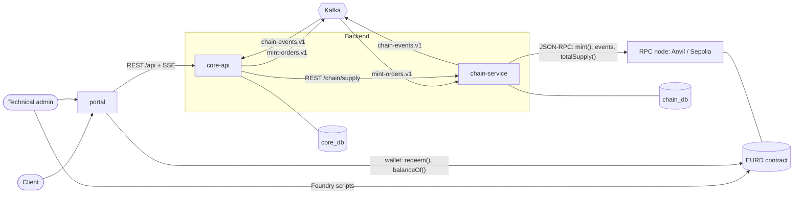
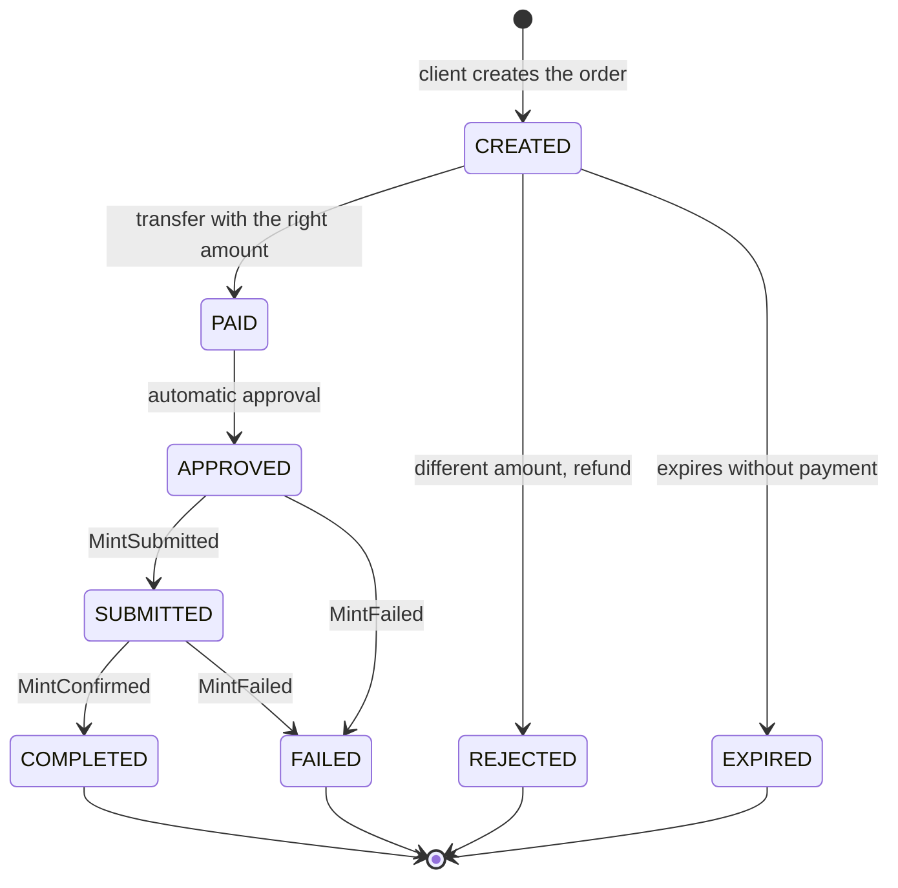
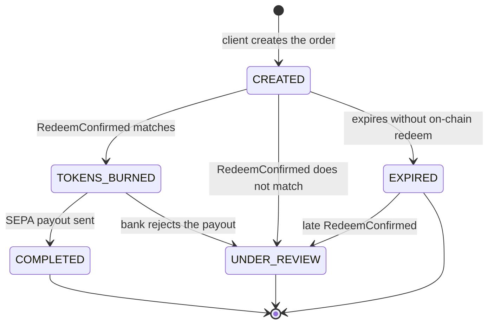
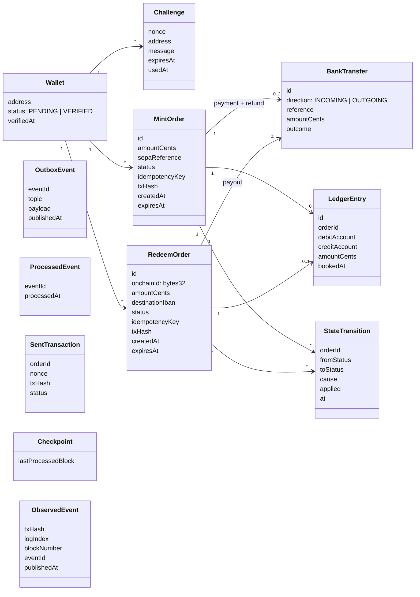
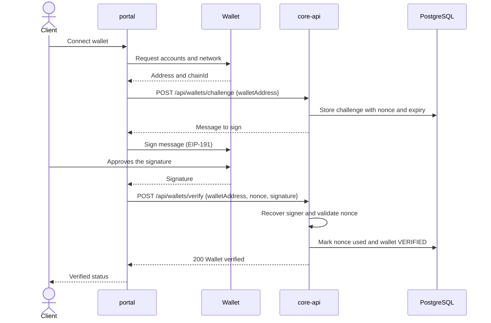
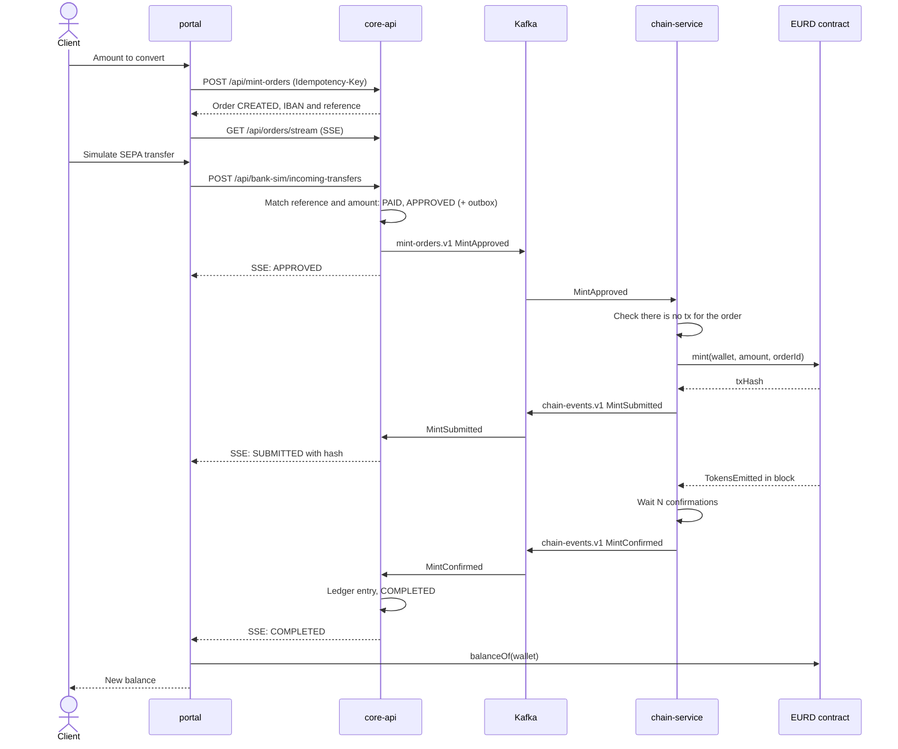
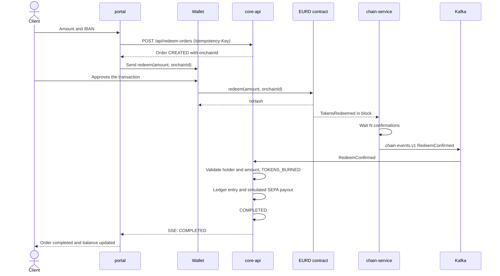
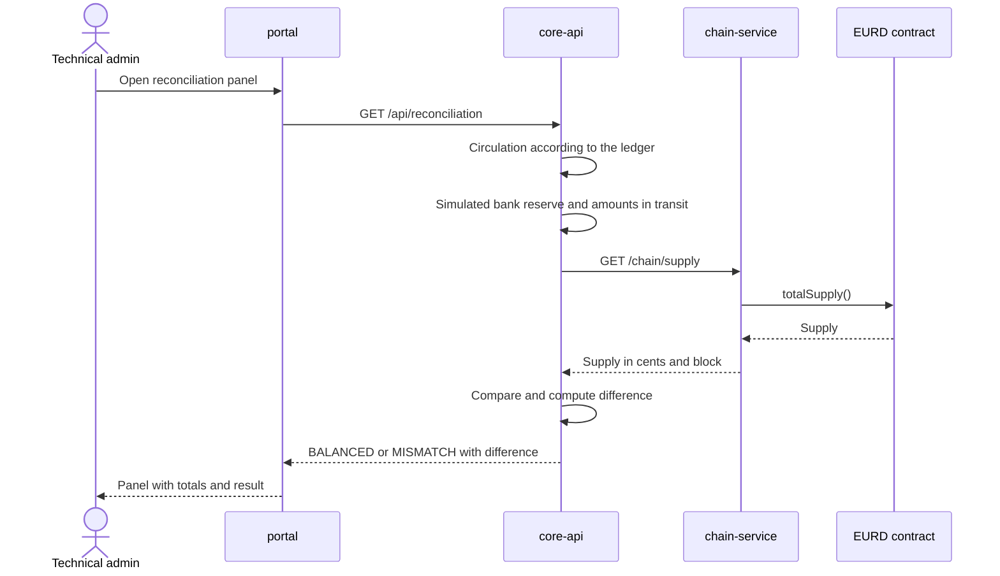

# Architecture

This document is the English, versioned copy of the architecture in the functional requirements. The integration contracts live next to it:

- REST: [`core-api/src/main/resources/api-definition.yml`](../core-api/src/main/resources/api-definition.yml) and [`chain-service/src/main/resources/api-definition.yml`](../chain-service/src/main/resources/api-definition.yml)
- Kafka: [`events.md`](events.md)

## Components

| Component | Responsibility | Exposes | Consumes |
|---|---|---|---|
| EURD contract | Token state: balances, supply, roles, pause and blacklist | On-chain functions and events | — |
| core-api | Wallets, orders, simulated bank, ledger and reconciliation | REST `/api`, SSE, topic `mint-orders.v1` | Topic `chain-events.v1`, chain-service REST |
| chain-service | The only backend component that writes and reads the chain | REST `/chain`, topic `chain-events.v1` | Topic `mint-orders.v1`, JSON-RPC |
| portal | Client UI and reconciliation panel | Web screens | REST `/api`, SSE, the user's wallet |
| Kafka | Asynchronous transport between core-api and chain-service | Topics | — |
| PostgreSQL | Persistence, one database per service (`core_db`, `chain_db`) | SQL | — |

No component reads another component's database. Redeem is the only operation that reaches the contract without going through the backend: the client's wallet signs and sends it.

## Conventions

- **Amounts:** the backend always works in integer euro cents. The contract has 6 decimals, so 1 cent = 10,000 token units. The conversion only happens in chain-service and the portal.
- **Addresses:** normalized before being stored or compared (stored lowercase, returned in EIP-55 checksum format).
- **Order ids:** UUIDs in the backend, bytes32 on-chain (rule in [`events.md`](events.md#order-id-uuid--bytes32)).

## Transaction boundaries

core-api uses `JdbcClient` with Spring's declarative transactions. The rule is:

> A service method gets `@Transactional` when it makes **more than one write that must succeed or fail together**. A single statement does not need it: with autocommit, one statement is already atomic.

Under `@Transactional`, Spring opens one transaction when the method starts, every `JdbcClient` call inside it uses that transaction's connection, and it commits when the method returns. Any `RuntimeException` (including `ApiException`) rolls back all the writes. Without the annotation, each call autocommits on its own, so a failure halfway through leaves the earlier writes committed.

### CU-01: generate a challenge (`WalletsService.generateWalletChallenge`)

| Step | Statement |
|---|---|
| 1 | `INSERT INTO wallets ... ON CONFLICT DO NOTHING` registers the wallet as `PENDING` |
| 2 | `INSERT INTO wallet_challenges ...` stores the nonce, message and expiry |

The order is forced by the schema: `wallet_challenges.wallet_address` is a foreign key to `wallets`. Here the transaction is mostly for consistency (one request = one unit of work). If step 2 failed after step 1 committed, the result would be a `PENDING` wallet with no challenge. That is still a valid state, and the next request reuses it because step 1 is idempotent. Concurrent requests for the same address are safe without the transaction too, because of `ON CONFLICT`.

### CU-01: verify the signature (`WalletsService.verifyWalletSignature`)

| Step | Statement |
|---|---|
| 1 | `SELECT` the challenge by nonce and address. The service then returns a specific error: `INVALID_NONCE` (not found), `NONCE_ALREADY_USED` or `CHALLENGE_EXPIRED` |
| — | Recover the EIP-191 signer in Java and compare it with the wallet address |
| 2 | `UPDATE wallet_challenges SET used_at = NOW() WHERE ... AND used_at IS NULL` consumes the nonce |
| 3 | `UPDATE wallets SET status = 'VERIFIED', verified_at = COALESCE(verified_at, NOW()) ... RETURNING verified_at` |

Here the transaction is essential. Without it:

- If step 2 committed and step 3 failed, the nonce would be burned while the wallet stayed `PENDING`. The user would have to request and sign a new challenge.
- Step 3 must never be committed without step 2, or the same signature could verify the wallet again later.

**Single use under concurrency.** The `SELECT` in step 1 alone does not stop two concurrent requests that send the same signature: both can read the challenge as unused. Step 2 handles that with a conditional `UPDATE`. The `used_at IS NULL` guard is checked when the row is updated, and PostgreSQL's row lock makes the second request wait for the first one to finish. It then re-checks the condition, finds `used_at` already set and updates 0 rows. The service treats 0 rows as `NONCE_ALREADY_USED` and throws, which rolls back that request's transaction. This gives single use without `SELECT ... FOR UPDATE` or a stricter isolation level than PostgreSQL's default `READ COMMITTED`.

`COALESCE(verified_at, NOW())` keeps the first verification timestamp if an already verified wallet signs a new challenge. Together with the `CHECK ((status = 'VERIFIED') = (verified_at IS NOT NULL))` constraint, this keeps `status` and `verified_at` consistent.

### Pitfall: self-invocation

`@Transactional` works through a Spring proxy, so it only applies when the method is called from another bean (for example, the controller calling `WalletsService`). If one method of `WalletsService` calls another `@Transactional` method of the same class, the call skips the proxy and the inner annotation is ignored. The transaction boundary is therefore placed on the public service method that the controller calls.

## Order statuses

The code uses English names. Mapping to the names in the functional requirements:

| Requirements (ES) | Code | Mint | Redeem |
|---|---|:-:|:-:|
| CREADA | `CREATED` | ✓ | ✓ |
| PAGADA | `PAID` | ✓ | |
| RECHAZADA | `REJECTED` | ✓ | |
| CADUCADA | `EXPIRED` | ✓ | ✓ |
| APROBADA | `APPROVED` | ✓ | |
| ENVIADA | `SUBMITTED` | ✓ | |
| COMPLETADA | `COMPLETED` | ✓ | ✓ |
| FALLIDA | `FAILED` | ✓ | |
| TOKENS_QUEMADOS | `TOKENS_BURNED` | | ✓ |
| REVISION | `UNDER_REVIEW` | | ✓ |
| PENDIENTE / VERIFICADA (wallet) | `PENDING` / `VERIFIED` | | |
| ENTRANTE / SALIENTE (transfer) | `INCOMING` / `OUTGOING` | | |
| CUADRA / DESCUADRE (reconciliation) | `BALANCED` / `MISMATCH` | | |

### Mint order

Any transition not in this diagram is rejected and recorded (RF-CORE-22).

A `FAILED` order has received the euros but no tokens were minted: in the demo it is resolved by hand, and the reconciliation panel shows it as an amount in transit.

### Redeem order

If a `RedeemConfirmed` arrives for an order that is already `EXPIRED`, the tokens were burned anyway: the order goes to `UNDER_REVIEW` instead of being ignored.

## Data model

`SentTransaction`, `Checkpoint` and `ObservedEvent` live in `chain_db` (chain-service); everything else in `core_db` (core-api). Migrations: `core-api/src/main/resources/db/migration` and `chain-service/src/main/resources/db/migration`.

Ledger (RF-CORE-16): two accounts, `BANK_RESERVE` and `EURD_CIRCULATION`. A completed mint debits the reserve and credits circulation; a redeem does the reverse. Entries are append-only (a database trigger rejects `UPDATE` and `DELETE`).

## Sequence diagrams

### CU-01 Connect and verify wallet

### CU-02, CU-03 and CU-04 Request mint, pay and issue

### CU-06 and CU-07 Request and settle redeem

### CU-08 Reconciliation

